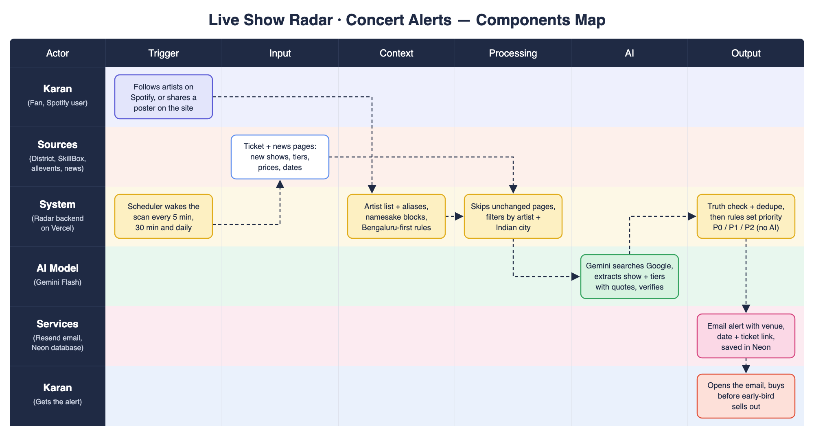

# Live Show Radar: Components Map

**In one line:** schedulers wake the app → it reads ticket and news sites for Karan's Spotify artists → Gemini Flash pulls out the show details → rules check the facts and remove duplicates → an email alerts Karan once per new fact.

Rows are the actors (Karan, Sources, System, AI Model, Services); columns are Trigger → Input → Context → Processing → AI → Output. Vector version: [`components-map.svg`](components-map.svg).

| Layer | What it is | Example |
|---|---|---|
| **Trigger** | GitHub Actions every 5 min (quick check) and every 30 min (Google Search sweep); Vercel Cron once a day; Karan sharing a link or poster on the site; admin "Scan now" | Vercel's free plan only allows a daily cron, so the frequent runs come from GitHub Actions |
| **Input** | Followed artists (Spotify, or a 60-artist seed list); District and SkillBox sitemaps; allevents pages; Bing News; Google Search results; forwarded posters and links | District event pages list every ticket tier and price |
| **Context** | Must-see / like / casual tiers, artist aliases, namesake blocks, venue sizes, Bengaluru-first rules, quiet hours, past feedback | "Phoenix Marketcity" is a mall, not the band Phoenix |
| **Processing** | Skip unchanged pages → name and city filter → truth check (every fact must be quoted) → merge duplicates → decide what's new → priority P0/P1/P2 → reminders | Same show from 2 sites = 1 event with 2 sources |
| **AI** (Gemini Flash only) | Google Search scout · extract show details · read posters · second-pass verify · same-artist check · whisper signals · one "why it matters" line | `google/gemini-3.8-flash`, via OpenRouter on Google's own servers |
| **Output** | Email alert (Resend), reminders (24 h / 1 h / 10 min), .ics calendar file, public dashboard, daily "what we checked" digest | "EARLY-BIRD OPEN NOW, deadline not stated" |

**Kept out of AI on purpose:** priority, dedupe, dates and times, and every price, time and deadline check are plain code, so an alert can't contain an invented fact.
