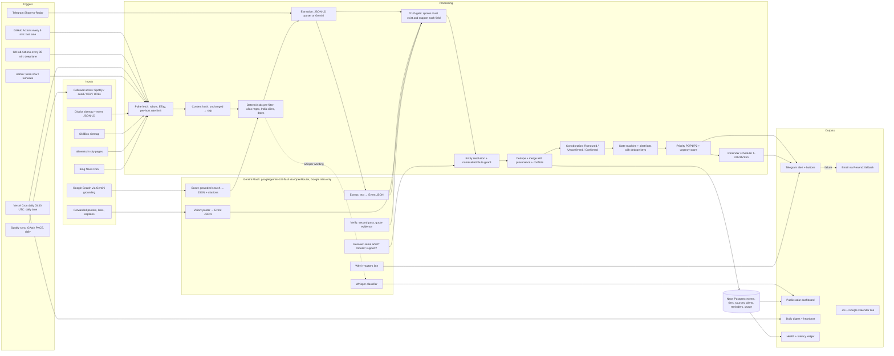

# Live Show Radar: Components Map

Live Show Radar watches the India concert calendar for every artist Karan follows (Bengaluru first), and alerts him on Telegram/email the moment a show or an early-bird window appears. Every ticket fact is quoted, labelled inferred, or marked "not stated".

| Layer | Components | Where in code |
|---|---|---|
| **Trigger** | 5-minute fast lane and 30-minute deep lane from external schedulers (GitHub Actions `scan.yml`; cron-job.org/QStash as redundancy), daily Vercel Cron (03:30 UTC ≈ 09:00 IST), Telegram share (webhook), admin **Scan now** / **Simulate announcement**, Spotify sync (OAuth PKCE, daily re-sync) | `app/api/cron/scan`, `app/api/cron/daily`, `app/api/telegram/webhook`, `app/api/admin/*`, `lib/scheduler/*` |
| **Input** | Followed-artist list (Spotify `/me/following` + `/me/top/artists`; seed list; CSV/URL/name import); ticketing pages (District sitemap + event JSON-LD, SkillBox sitemap; BookMyShow/Ticketgenie are blocked and only reach us via search); aggregator pages (allevents.in); news RSS (Bing News; Google News off: robots.txt); Google Search results via Gemini grounding; forwarded posters, links and captions | `lib/sources/adapters/*`, `lib/spotify/spotify.ts` |
| **Context** | Affinity tiers (must-see / like / casual + manual star), aliases (stage names, "The" prefix, transliterations), namesake/tribute blocks, venue capacities (approximate), Bengaluru-first priority rules and quiet hours, dedupe memory (fingerprints, content hashes, ETags, sitemap cursors), feedback history (affinity changes, blocks, confidence threshold) | `artists`, `artist_aliases`, `artist_blocks`, `venues`, `settings`, `observations`, `http_cache`, `feedback` tables |
| **Processing** | Change detection (ETag / content hash), deterministic pre-filters, extraction (JSON-LD parser first, Gemini otherwise, heuristic fallback), truthfulness gate, entity resolution + namesake/tribute guard, corroboration (Confirmed needs 1 primary or 2 independent sources), dedupe/merge (artists + city + date ±1 day + fuzzy venue) with conflicts kept, event state machine, alert-fact transitions with dedupe keys, priority P0/P1/P2 + urgency score, reminder scheduling | `lib/text/*`, `lib/pipeline/*`, `lib/domain/rules.ts`, `lib/alerts/*` |
| **AI** (Gemini Flash only) | 1. Scout: grounded search → structured candidates + source URLs · 2. Extraction: page text → Event JSON · 3. Vision: posters/screenshots → Event JSON · 4. Entity resolution: same artist / tribute / support · 5. Verification: second pass quotes evidence, unsupported fields rejected · 6. Whisper classification · 7. "Why it matters" line. Model `google/gemini-3.8-flash` via OpenRouter, `provider.only = google-vertex / google-ai-studio`, no fallbacks; zod-validated, retry once, 429 backoff + cooldown, daily budget with priority reserve, content-hash cache, `gemini_usage` log | `lib/ai/gemini.ts`, `lib/ai/tasks.ts` |
| **Output** | Telegram alerts (inline buttons: Open tickets, Going, Maybe, Not interested, Wrong info, Wrong artist, Add to calendar, Remind me), email via Resend (urgent alerts + fallback), sale-window reminders, `.ics` with T-24h/1h/10m alarms + Google Calendar link, public radar dashboard, daily digest ("Checked N artists across M sources…"), health page with source status, Gemini budget, coverage and the latency ledger (median/p90) | `lib/notify/*`, `lib/alerts/ics.ts`, `app/*` |

**Not AI on purpose:** the alert text (except the one "why" line), priority, dedupe, state machine, dates and timezones, and every price, time and deadline check. All of these are deterministic, so nothing in an alert can be invented.
